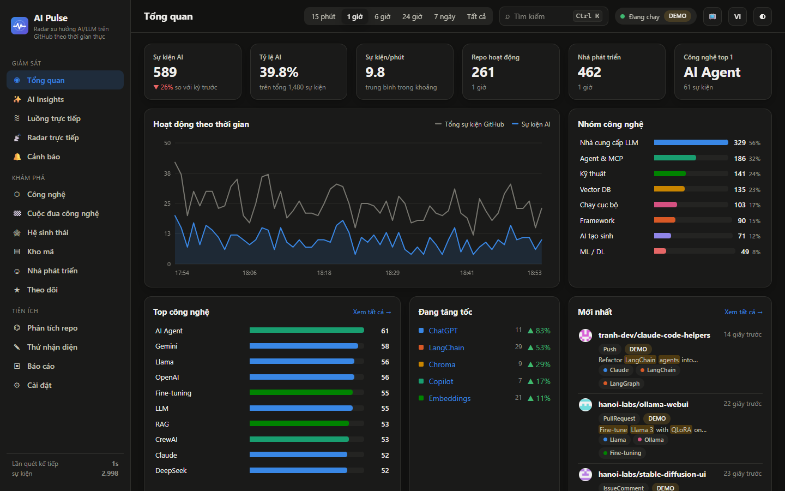
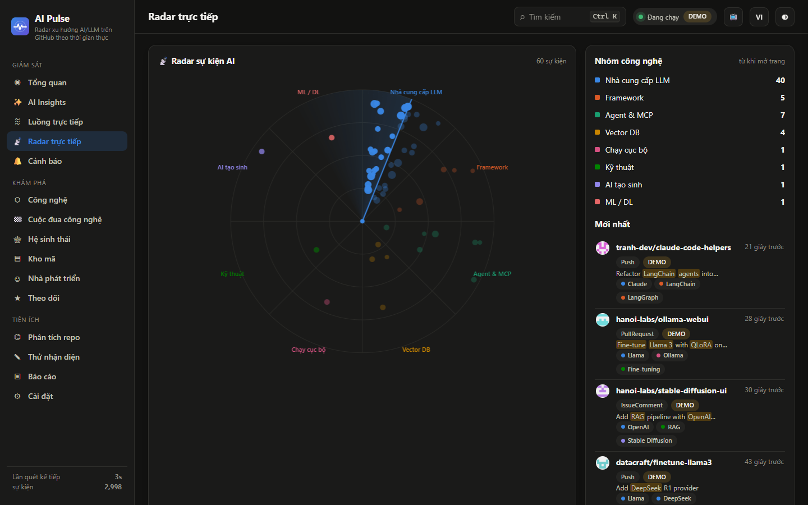
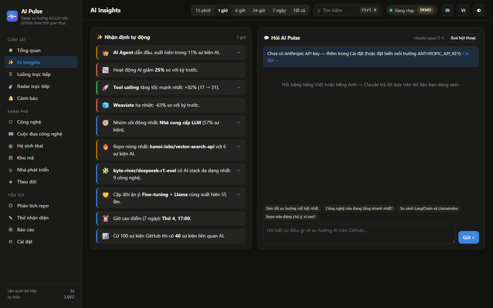
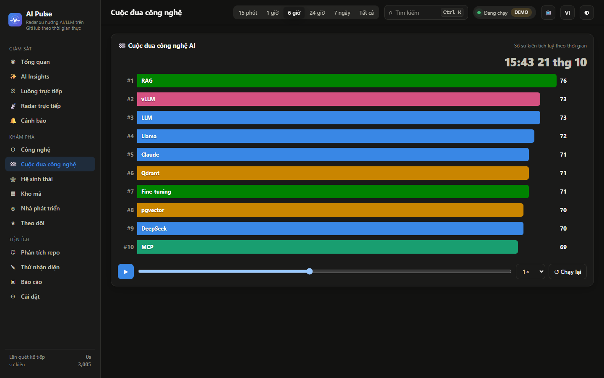
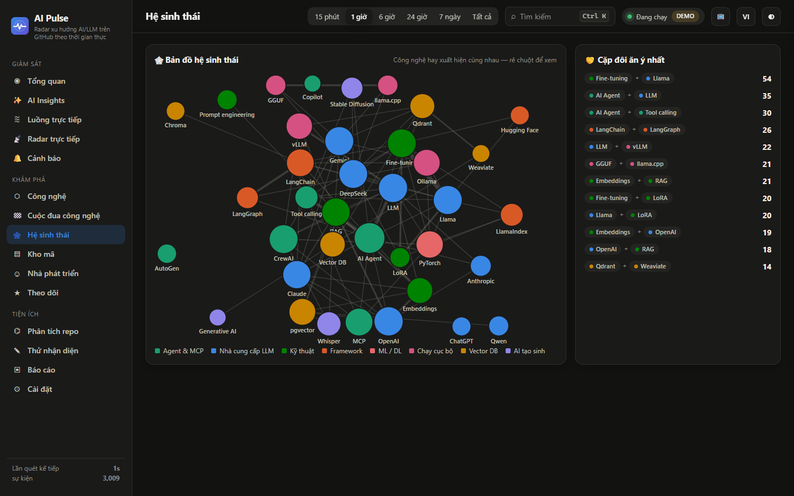
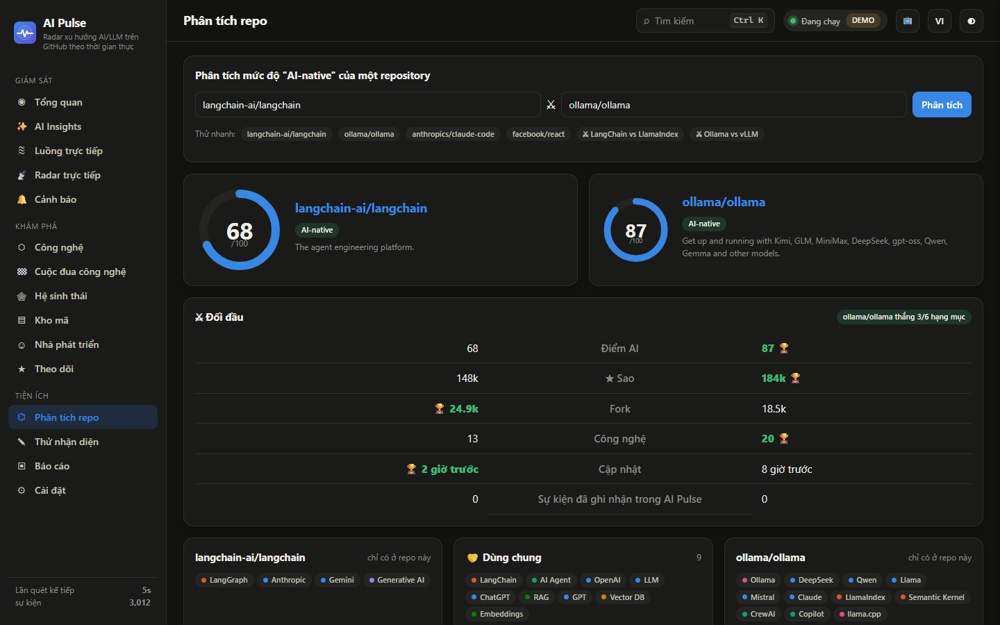
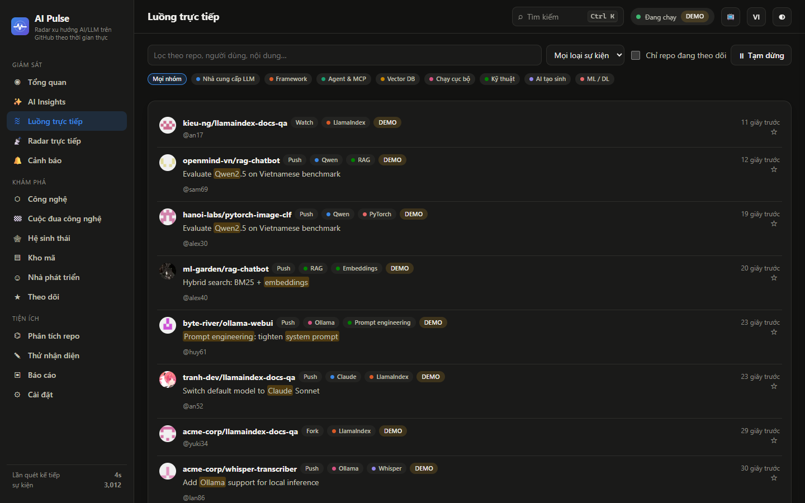
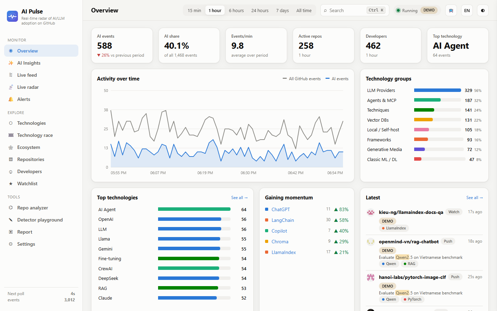
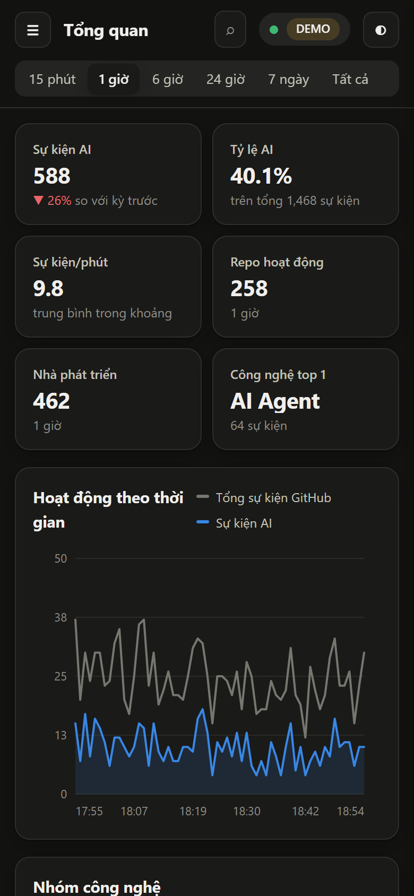

<p align="center">
  
</p>

<p align="center">
  <a href="https://github.com/TienQuangPP/ai-pulse/actions/workflows/ci.yml"></a>
  
  
  
  
  
</p>

<p align="center">
  <b>Cộng đồng mã nguồn mở đang xây gì với AI — ngay lúc này?</b><br/>
  AI Pulse nghe luồng sự kiện công khai của GitHub, nhận diện <b>50+ công nghệ AI/LLM</b> trong từng commit, PR, issue,<br/>
  rồi biến chúng thành radar trực tiếp, cuộc đua công nghệ, bản đồ hệ sinh thái và nhận định do AI viết.
</p>

<p align="center">
  <a href="#-chạy-trong-30-giây">Chạy thử</a> ·
  <a href="#-tính-năng">Tính năng</a> ·
  <a href="#-ảnh-chụp">Ảnh chụp</a> ·
  <a href="#-độ-chính-xác">Độ chính xác</a> ·
  <a href="#-bảo-mật">Bảo mật</a> ·
  <a href="#-api">API</a>
</p>

<p align="center">
  
</p>

---

## ⚡ Chạy trong 30 giây

Chỉ cần **Node.js 20+**: không Docker, không Python, không cần `npm install`.

```bash
git clone https://github.com/TienQuangPP/ai-pulse.git
cd ai-pulse
npm start            # mở http://localhost:8787
```

| Cách khác | |
|---|---|
| 🪟 Windows | nhấp đúp **`AI-Pulse.bat`** (tự mở trình duyệt) |
| 🍎 macOS / 🐧 Linux | `sh ai-pulse.sh` |
| 🧪 Demo không cần mạng | `npm run demo` |
| 🐳 Docker | `docker compose up -d` (chỉ mở trên `127.0.0.1`) |
| 📲 Cài như app | mở bằng Chrome/Edge → biểu tượng **Cài đặt** trên thanh địa chỉ |

<details>
<summary><b>🔑 Tuỳ chọn: GitHub token và Claude</b></summary>

| | Không có | Có |
|---|---|---|
| **GitHub token** | 60 request/giờ, quét 60 giây/lần | 5.000 request/giờ, tối đa 3 trang mỗi 5–10 giây |
| **Anthropic API key** + `npm install` | AI Insights vẫn có nhận định tự động | thêm chat **"Hỏi AI Pulse"**: Claude trả lời dựa trên dữ liệu bạn đang xem |

Nhập trong **Cài đặt** hoặc tạo `.env` từ [`.env.example`](.env.example). Khoá chỉ nằm trên máy bạn (`.runtime/config.json`, đã loại khỏi Git) và không bao giờ được API trả ngược ra trình duyệt.
</details>

---

## ✨ Tính năng

<table>
<tr>
<td width="50%" valign="top">

### 📡 Giám sát trực tiếp
- **Tổng quan**: 6 KPI, biểu đồ thời gian, nhóm công nghệ, công nghệ đang tăng tốc, bản đồ nhiệt giờ × thứ.
- **Radar trực tiếp**: mỗi sự kiện AI hiện thành một chấm sáng trên radar có tia quét; bấm vào để mở repo.
- **Luồng trực tiếp**: đẩy về tức thì qua SSE, tô sáng từ khoá, lọc nhiều chiều, tạm dừng không mất sự kiện.
- **Cảnh báo**: "*≥ N sự kiện của X trong M phút*", có thông báo trình duyệt.

</td>
<td width="50%" valign="top">

### ✨ AI Insights
- **Nhận định tự động** (VI/EN): công nghệ dẫn đầu, tăng tốc, hạ nhiệt, mới xuất hiện, repo nóng, cặp công nghệ hay đi cùng nhau, giờ cao điểm.
- **Hỏi AI Pulse**: chat với **Claude**, câu trả lời bám theo dữ liệu của khoảng thời gian đang chọn; tự dừng khi bạn đóng tab và có giới hạn tần suất để không đốt chi phí.

</td>
</tr>
<tr>
<td valign="top">

### 🔭 Khám phá
- **Cuộc đua công nghệ**: biểu đồ cột tự chạy, phát lại thứ hạng theo thời gian.
- **Hệ sinh thái**: đồ thị lực các công nghệ xuất hiện cùng nhau.
- **Công nghệ**: so sánh xu hướng tối đa 6 công nghệ.
- **Kho mã**, **Nhà phát triển**, **Theo dõi ☆**.

</td>
<td valign="top">

### 🧰 Tiện ích
- **Phân tích repo**: điểm AI 0–100, kèm điểm theo từng nguồn (tên, mô tả, topics, phụ thuộc, README). **⚔ So sánh đối đầu** hai repo.
- **Thử nhận diện** văn bản bất kỳ · **Báo cáo** in/PDF · **Xuất** CSV/JSON · **Nhập** JSON · từ khoá tuỳ chỉnh.

</td>
</tr>
</table>

**Trải nghiệm:** 🌐 VI/EN · 🌗 sáng/tối · 📱 dùng tốt trên điện thoại · ⌨️ `Ctrl K` · 📺 **chế độ TV** (phím `F`) · 🎉 mừng cột mốc · ♿ tôn trọng `prefers-reduced-motion`.

---

## 📸 Ảnh chụp

> Chụp từ chế độ demo (dữ liệu mô phỏng); riêng phần so sánh repo dùng dữ liệu GitHub thật.

| 📡 Radar trực tiếp | ✨ AI Insights |
|---|---|
|  |  |
| **🏁 Cuộc đua công nghệ** | **🕸 Hệ sinh thái** |
|  |  |
| **⚔ So sánh đối đầu** | **≋ Luồng trực tiếp** |
|  |  |

<p align="center">
  
  
</p>

---

## 🎯 Độ chính xác

Một app phân tích chỉ đáng tin khi số liệu đáng tin. AI Pulse xử lý ba nguồn sai số phổ biến:

| Vấn đề | Cách xử lý |
|---|---|
| **Khớp chuỗi con**: `rag` trong `storage`, `gpt` trong `gptables` | So khớp theo ranh giới từ; tách camelCase (`RagPipeline` → `rag pipeline`) |
| **Từ đa nghĩa**: MCP của Minecraft, mạch LoRa, phân vùng GPT, `torch`, `grok`, `whisper`, `embedding`… | Chia mẫu **mạnh / yếu**: từ yếu chỉ được tính khi cùng sự kiện có tín hiệu AI mạnh. Riêng file phụ thuộc thì được tính, vì ở đó tên package là rõ ràng |
| **Xu hướng ảo** khi vừa khởi động | Chỉ so sánh với kỳ trước khi kỳ đó đã được quan sát đầy đủ. "Đang tăng tốc" so hai nửa của khoảng đang xem |

Số liệu phản ánh **mẫu sự kiện công khai** mà GitHub Events API trả về (trễ khoảng 5 phút), không phải toàn bộ mức sử dụng AI trên GitHub.

---

## 🔒 Bảo mật

| Lớp | Bảo vệ |
|---|---|
| **CSRF** | Mọi thao tác ghi phải là JSON và đến từ cùng nguồn (`Origin` / `Sec-Fetch-Site`); trang web lạ không thể âm thầm xoá dữ liệu hay gọi Claude bằng key của bạn |
| **DNS rebinding** | Chỉ chấp nhận `localhost`, địa chỉ IP, hoặc tên miền trong `AIPULSE_ALLOWED_HOSTS` |
| **Mở ra mạng** | Đặt `AIPULSE_ADMIN_TOKEN` thì mọi thao tác ghi đều cần token; server cảnh báo khi chạy ngoài localhost mà chưa có token |
| **Trình duyệt** | CSP chặt (không script inline), `X-Frame-Options: DENY`, `nosniff`, `no-referrer` |
| **Dữ liệu xuất** | Chặn CSV injection (`=`, `+`, `-`, `@`) khi mở bằng Excel |
| **Độ bền** | URL hỏng không làm sập server; giới hạn kích thước body; lưu file nguyên tử và bất đồng bộ |

---

## ⚙️ Cấu hình

| Biến | Công dụng |
|---|---|
| `GITHUB_TOKEN` | Tăng giới hạn GitHub API |
| `ANTHROPIC_API_KEY` | Chat Claude (cần `npm install` một lần cho SDK tuỳ chọn) |
| `AIPULSE_MODE` | `live` hoặc `demo` |
| `AIPULSE_DATA_DIR` | Thư mục dữ liệu, mặc định `.runtime/` |
| `AIPULSE_ADMIN_TOKEN` | Bắt buộc token cho thao tác ghi (nên đặt khi `HOST=0.0.0.0`) |
| `AIPULSE_ALLOWED_HOSTS` | Tên miền được phép ngoài localhost/IP |
| `HOST`, `PORT` | Mặc định `127.0.0.1:8787` |

## 🗂 Cấu trúc

```text
server/      HTTP + bảo mật, GitHub collector, detector, store, insights, analyzer, chat Claude
public/      PWA: HTML/CSS/JS thuần, biểu đồ SVG/Canvas tự viết, VI/EN
tests/       node:test — detector, store, bảo mật, HTTP, i18n
assets/      Banner và ảnh chụp
.github/     CI chạy test trên Node 20/22/24 (Linux) và Windows
```

## 🔌 API

| Endpoint | Nội dung |
|---|---|
| `GET /api/summary?range=15m\|1h\|6h\|24h\|7d\|all` | KPI, timeline, công nghệ, nhóm, xu hướng, heatmap |
| `GET /api/insights` · `GET /api/ecosystem` · `GET /api/race` | Nhận định, đồ thị đồng xuất hiện, khung hình cuộc đua |
| `GET /api/events` · `GET /api/repos` · `GET /api/developers` | Sự kiện, kho mã, nhà phát triển |
| `GET /api/analyze?repo=owner/name` | Điểm AI và AI stack của repository |
| `GET /api/detect?text=` | Chạy bộ nhận diện trên văn bản |
| `GET /api/export?dataset=…&format=csv\|json` · `POST /api/import` | Xuất / nhập dữ liệu |
| `GET /api/stream` | Server-Sent Events: `events`, `tick`, `status`, `alert`, `config` |
| `POST /api/ask` | Chat Claude (stream) |

```bash
npm test     # 34 kiểm thử
```

---

## 👤 Tác giả

<table>
<tr>
<td><a href="https://github.com/TienQuangPP"></a></td>
<td>
<b><a href="https://github.com/TienQuangPP">@TienQuangPP</a></b><br/>
Thiết kế, phát triển và duy trì AI Pulse.<br/>
<sub>Góp ý hoặc báo lỗi: mở <a href="https://github.com/TienQuangPP/ai-pulse/issues">Issue</a>.</sub>
</td>
</tr>
</table>
